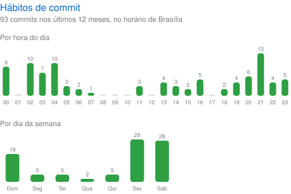

### Olá, eu sou o Saulo

Estudante de Engenharia de Computação na UFPB e estagiário de desenvolvimento em João Pessoa. Construo automações, ferramentas internas e integrações com modelos de linguagem, do protótipo ao deploy.

  
  
  
  

#### Tecnologias

Também: DuckDB, dbt, pandas, Playwright, WebRTC, API do Claude e MCP.

#### Agora

- Estágio de desenvolvimento e automação na Virtus Consultoria
- Pesquisa e desenvolvimento em saúde digital no PET-Saúde (UFPB / SUS-PB)
- Oluasin em piloto com colegas
