<picture><source media="(prefers-color-scheme: dark)" srcset="assets/hero-dark.svg"></picture>

  
  
  
  

<picture><source media="(prefers-color-scheme: dark)" srcset="assets/impacto-dark.svg"></picture>

<picture><source media="(prefers-color-scheme: dark)" srcset="assets/divisor-dark.svg"></picture>

## 00 · system prompt

<picture><source media="(prefers-color-scheme: dark)" srcset="assets/term-system-prompt-dark.svg"></picture>

<picture><source media="(prefers-color-scheme: dark)" srcset="assets/divisor-dark.svg"></picture>

## 01 · retrieved chunks

top-k = 3 · o código é privado (empresa ou produto próprio); cada fonte leva a uma demo com dados fictícios

<a href="https://sauloscm.github.io/projetos/warehouse-mcp/"><picture><source media="(prefers-color-scheme: dark)" srcset="assets/pipeline-sagaz-dark.svg"></picture></a>

<table>
<tr>
<td width="110" valign="top"><code>query</code></td>
<td valign="top"><strong>Sagaz</strong> · Nov 2026 Pergunte sobre os dados de um ERP em português e receba a resposta com o SQL que a comprova.</td>
</tr>
<tr>
<td valign="top"><code>context</code></td>
<td valign="top">API do Claude · MCP (FastMCP) · DuckDB · dbt · Python · Flask</td>
</tr>
<tr>
<td valign="top"><code>output</code></td>
<td valign="top">

- Warehouse em DuckDB e dbt (staging, core e marts, com testes) sobre o backup de um ERP contábil de cerca de 5.000 tabelas.
- O agente escolhe as tabelas pelo catálogo, roda SQL em modo somente leitura e mostra a consulta junto da resposta.
- Pede esclarecimento quando a pergunta é ambígua, lembra a conversa e registra tokens e custo de cada pergunta.
- As mesmas ferramentas ficam disponíveis para qualquer cliente MCP.

</td>
</tr>
<tr>
<td valign="top"><code>source</code></td>
<td valign="top"><a href="https://sauloscm.github.io/projetos/warehouse-mcp">sauloscm.github.io/projetos/warehouse-mcp</a></td>
</tr>
</table>

<a href="https://sauloscm.github.io/projetos/central-automacoes/"><picture><source media="(prefers-color-scheme: dark)" srcset="assets/pipeline-nexo-dark.svg"></picture></a>

<table>
<tr>
<td width="110" valign="top"><code>query</code></td>
<td valign="top"><strong>Nexo</strong> · Set 2026 Uma porta só para as automações da empresa, com quem pode o quê e o registro de cada execução.</td>
</tr>
<tr>
<td valign="top"><code>context</code></td>
<td valign="top">Node.js · Express · PostgreSQL · Flask · FastAPI · Playwright · Docker Compose</td>
</tr>
<tr>
<td valign="top"><code>output</code></td>
<td valign="top">

- Portal com login por pessoa e permissões por automação; cada automação roda no seu container, numa rede interna isolada.
- Robô com Playwright que entra num portal com verificação em duas etapas e confere as taxas cobradas venda a venda.
- Emissor de NFS-e no padrão nacional: XML assinado com certificado digital, DANFSe em PDF e envio por e-mail.
- Painel de execuções com progresso ao vivo e agendamento que roda as automações sozinho.

</td>
</tr>
<tr>
<td valign="top"><code>source</code></td>
<td valign="top"><a href="https://sauloscm.github.io/projetos/central-automacoes">sauloscm.github.io/projetos/central-automacoes</a></td>
</tr>
</table>

<a href="https://sauloscm.github.io/projetos/oluasin/"><picture><source media="(prefers-color-scheme: dark)" srcset="assets/pipeline-oluasin-dark.svg"></picture></a>

<table>
<tr>
<td width="110" valign="top"><code>query</code></td>
<td valign="top"><strong>Oluasin</strong> · 2026 Chat, voz, tela, páginas, kanban e planilha para equipes, com os dados nos próprios PCs.</td>
</tr>
<tr>
<td valign="top"><code>context</code></td>
<td valign="top">Electron · React · TypeScript · SQLite · WebRTC · Rust/WebAssembly · Cloudflare Workers</td>
</tr>
<tr>
<td valign="top"><code>output</code></td>
<td valign="top">

- Local-first: cada PC tem seu banco e os PCs sincronizam direto entre si, inclusive depois de ficarem offline.
- Voz e tela compartilhada ponto a ponto; páginas com importação do Notion, kanban, calendário e planilha com fórmulas em português.
- Licenças assinadas com Ed25519 e um painel que controla versões e máquinas sem nunca receber o conteúdo das equipes.
- Atualização automática assinada e testes de ponta a ponta com mais de 60 etapas, simulando dois PCs.

</td>
</tr>
<tr>
<td valign="top"><code>source</code></td>
<td valign="top"><a href="https://sauloscm.github.io/projetos/oluasin">sauloscm.github.io/projetos/oluasin</a></td>
</tr>
</table>

<picture><source media="(prefers-color-scheme: dark)" srcset="assets/divisor-dark.svg"></picture>

## 02 · ingestion log

mais recentes primeiro

<picture><source media="(prefers-color-scheme: dark)" srcset="assets/term-ingestion-log-dark.svg"></picture>

<picture><source media="(prefers-color-scheme: dark)" srcset="assets/divisor-dark.svg"></picture>

## 03 · embeddings

um namespace para cada tipo de coisa

<table>
<tr>
<td width="160" valign="top"><code>linguagens/</code></td>
<td>

</td>
</tr>
<tr>
<td valign="top"><code>ia/</code></td>
<td>

</td>
</tr>
<tr>
<td valign="top"><code>backend-frontend/</code></td>
<td>

</td>
</tr>
<tr>
<td valign="top"><code>dados/</code></td>
<td>

</td>
</tr>
<tr>
<td valign="top"><code>automação-infra/</code></td>
<td>

</td>
</tr>
</table>

<picture><source media="(prefers-color-scheme: dark)" srcset="assets/divisor-dark.svg"></picture>

## 04 · telemetry

a conta pessoal e a do estágio somadas; da conta do estágio entram só contagens

<picture><source media="(prefers-color-scheme: dark)" srcset="assets/telemetria-dark.svg"></picture>

<picture><source media="(prefers-color-scheme: dark)" srcset="assets/tocando-dark.svg"></picture>

<picture><source media="(prefers-color-scheme: dark)" srcset="assets/divisor-dark.svg"></picture>

## 05 · endpoint

<picture><source media="(prefers-color-scheme: dark)" srcset="assets/term-endpoint-dark.svg"></picture>

<a href="mailto:saulocm1@gmail.com">saulocm1@gmail.com</a> · <a href="https://www.linkedin.com/in/saulo-costa-ma">linkedin.com/in/saulo-costa-ma</a> · <a href="https://sauloscm.github.io">sauloscm.github.io</a>

