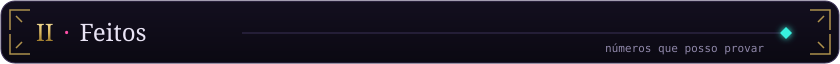
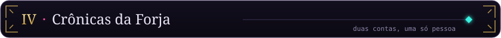
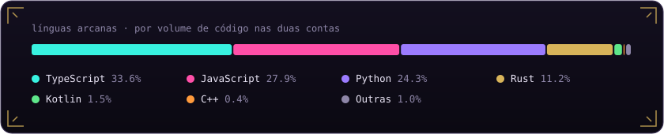
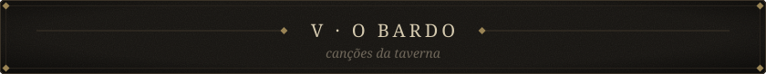

  
  
  
  

  

<table>
<tr><td width="170"><code>magia/</code></td><td>

</td></tr>
<tr><td><code>pergaminhos/</code></td><td>

</td></tr>
<tr><td><code>autômatos/</code></td><td>

</td></tr>
<tr><td><code>fortaleza/</code></td><td>

</td></tr>
</table>

forjado em João Pessoa · as crônicas se reescrevem todo dia ao amanhecer

